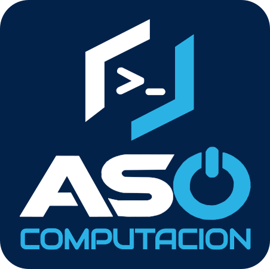
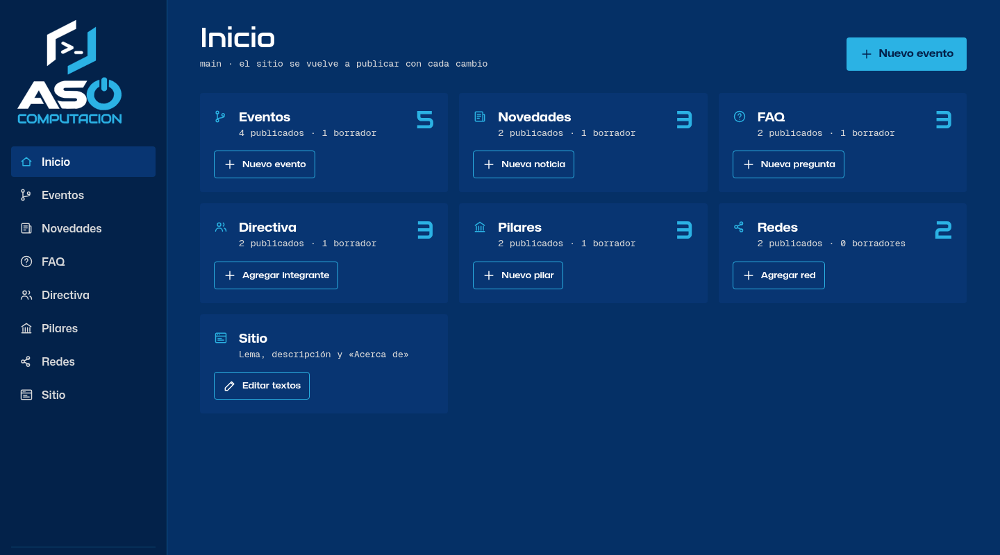
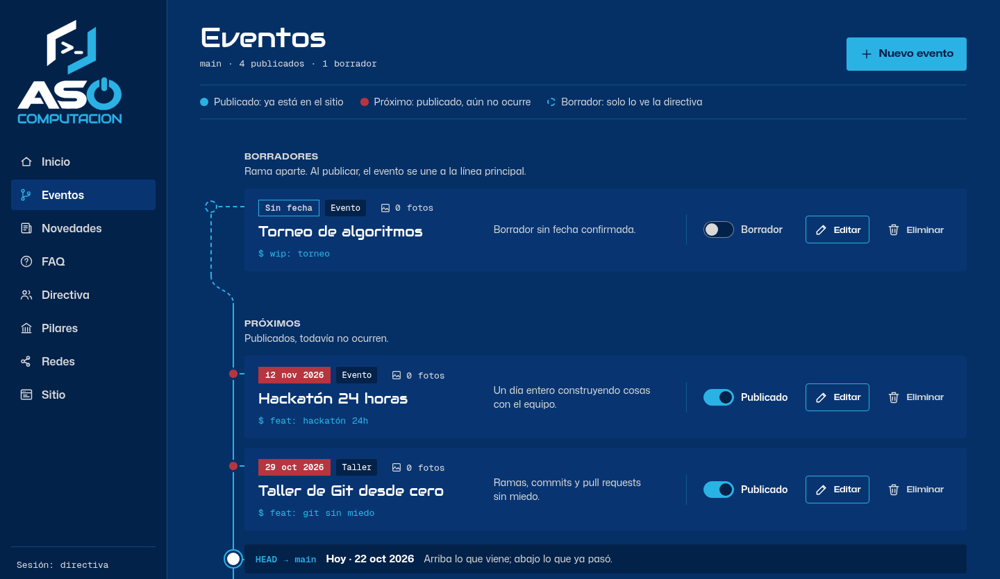
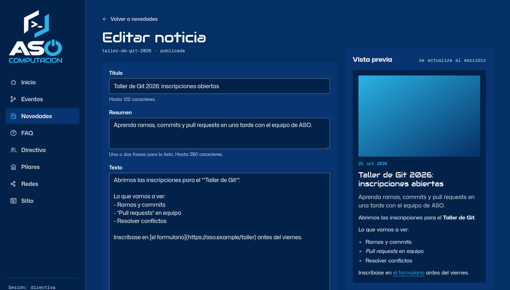
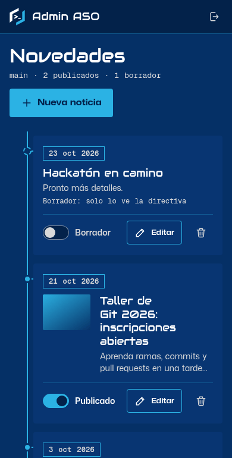

<div align="center">



# Panel de administración · ASO Computación

**La directiva edita el sitio público de la asociación sin escribir una línea de código.**

[](https://github.com/aso-computacion-unl/aso-computacion-admin/actions/workflows/ci.yml)
[](LICENSE)

[Sitio público](https://aso-computacion-landing.pages.dev) ·
[Panel](https://aso-computacion-admin.vercel.app) (acceso solo para la directiva) ·
[Documentación](#documentación)

</div>

## Qué es

Este panel permite que la directiva de ASO Computación mantenga el contenido del [sitio público](https://aso-computacion-landing.pages.dev): eventos con fotos, noticias, preguntas frecuentes, comandos de la terminal, directiva, pilares, redes sociales, aliados y textos del sitio. Cada cambio publicado le pide al sitio que se reconstruya a los pocos segundos, sin pasar por el código; el sitio se actualiza cuando termina esa construcción. El mismo servicio aloja el **foro de estudiantes** (`/foro`) y las **páginas de inscripción a eventos**. Cómo encajan el panel y el sitio está en [docs/ARQUITECTURA.md](docs/ARQUITECTURA.md).

<table>
  <tr>
    <td width="50%"><br><sub><b>Inicio:</b> un resumen de cada sección.</sub></td>
    <td width="50%"><br><sub><b>Eventos:</b> borradores, próximos y pasados en una línea de tiempo.</sub></td>
  </tr>
  <tr>
    <td width="50%"><br><sub><b>Noticias:</b> la vista previa se actualiza mientras se escribe.</sub></td>
    <td width="50%" align="center"><br><sub><b>En el teléfono:</b> el panel también se usa desde el celular.</sub></td>
  </tr>
</table>

> Las capturas usan datos de demostración.

## Qué permite

| Sección | Qué se administra |
|---|---|
| **Eventos** | Fechas (o solo el mes), tipo, enlace y galería de fotos; se pueden dejar como borrador. Cada evento elige cómo se inscribe la gente (sin inscripción, con cuenta de Google de la UNL o con un formulario abierto), con cupos y fecha límite opcionales; las inscripciones se ven por evento y en **Inscripciones**, y solo un administrador puede exportarlas o eliminarlas. Las inscripciones se borran solas 90 días después del evento |
| **Novedades** | Noticias con portada, fecha de publicación y vista previa en vivo |
| **FAQ** | Preguntas y respuestas, con el orden que se desee y, si se quiere, el comando de terminal que las muestra en el sitio |
| **Comandos** | Los comandos libres de la terminal del sitio: la palabra, su descripción y lo que imprime |
| **Directiva** | Nombre, cargo y foto de cada integrante (nunca datos de contacto) |
| **Pilares** | Las tarjetas de pilares que presenta el sitio |
| **Aliados** | Nombre y logo de quienes apoyan a la asociación, con un enlace opcional |
| **Redes** | Enlaces a las redes sociales |
| **Sitio** | Lema, descripción y texto «Acerca de» (solo administradores) |
| **Medios** | Todas las imágenes guardadas y dónde se usa cada una; un administrador puede buscar y eliminar las que ya no usa nadie |
| **Papelera** | Lo que se elimina va primero a la papelera: se puede restaurar (como borrador) o, solo un administrador, eliminar para siempre |
| **Foro** | Reportes de estudiantes: ocultar o mostrar una publicación, cerrar un hilo, suspender a un estudiante y cerrar el reporte |
| **Vista previa** | Códigos temporales (1 hora, 24 horas o 7 días) para ver borradores y contenido programado en el diseño real antes de publicarlo |
| **Usuarios** | Quién puede entrar con su cuenta de Google y con qué rol (editor o administrador); se suma gente con un link de invitación de un solo uso que vence a los 7 días |
| **Sesiones** | Dónde hay una sesión abierta y cerrarla; el administrador ve las de todos |
| **Registro** | Quién cambió qué y cuándo (solo administradores) |

Cada elemento se puede publicar u ocultar cuando se desee, y nada llega al sitio hasta que se publica. Los eventos y las noticias además pueden programarse (publicar o retirar en una fecha y hora). Las listas (FAQ, comandos, directiva, pilares, redes y aliados) también se pueden reordenar; eventos, noticias, FAQ y comandos tienen búsqueda y páginas, y todas las listas de contenido permiten acciones en lote. Falta una pantalla para crear las categorías del foro: por ahora se cargan desde la base de datos (ver la [guía de despliegue](docs/DEPLOY.md#4b-student-forum-foro)).

## Tecnologías

| Capa | Herramientas |
|---|---|
| Aplicación | Next.js 15 · React 19 · TypeScript |
| Datos | Prisma · PostgreSQL en Neon |
| Imágenes | Cloudinary |
| Identidad y antispam | Google (OAuth) · Cloudflare Turnstile en el formulario abierto de inscripción |
| Despliegue | Vercel (panel) · Cloudflare Pages (sitio público) |
| Errores | Sentry (opcional) |
| Calidad | Arquitectura hexagonal · Vitest · Playwright · CI en GitHub Actions · SonarCloud |

## Probarlo en local

Se necesita **Node 22** y una base de datos PostgreSQL propia (Docker sirve para levantar una). No debe usarse la de producción.

```sh
cp .env.example .env      # completar los valores __REPLACE_*__
npm ci
npx prisma migrate deploy
npm run dev               # http://localhost:3000
```

Sin las variables de Google, el acceso es la contraseña de emergencia (`ADMIN_PASSWORD`). Para ver el panel con contenido de ejemplo: `npm run seed:demo` (solo funciona contra una base local).

El foro de estudiantes (`/foro`) queda apagado hasta definir `FORUM_ALLOWED_EMAIL_DOMAIN=unl.edu.ec` y `FORUM_SESSION_SECRET`, y exige registrar en Google una segunda URI de redirección (`<AUTH_URL>/foro/auth/google/callback`): ver la [guía de despliegue](docs/DEPLOY.md#4b-student-forum-foro).

Las variables de entorno están explicadas en la [referencia técnica](docs/REFERENCIA.md#environment-variables) y el despliegue paso a paso, en la [guía de despliegue](docs/DEPLOY.md).

## Cómo colaborar

El contenido se edita desde el panel, sin tocar el código. Los cambios de código entran por Pull Request contra `main`, con una aprobación y la CI en verde. Los errores y las ideas se reportan abriendo un issue.

La guía completa está en [CONTRIBUTING.md](CONTRIBUTING.md). Las vulnerabilidades se reportan en privado, como indica [SECURITY.md](SECURITY.md).

## Documentación

| Documento | Para qué sirve |
|---|---|
| [README](README.md) | Presentación del proyecto (este documento) |
| [CONTRIBUTING.md](CONTRIBUTING.md) | Flujo de trabajo, reglas del código y buenas prácticas para la directiva |
| [docs/ARQUITECTURA.md](docs/ARQUITECTURA.md) | El sistema completo (panel y sitio público): quién es dueño de qué, cómo fluye el contenido, identidades, entornos y CI (en inglés) |
| [docs/DEPLOY.md](docs/DEPLOY.md) | Despliegue en Vercel, Neon y Cloudinary, con la lista de verificación (en inglés) |
| [docs/REFERENCIA.md](docs/REFERENCIA.md) | Referencia técnica: reglas, contratos y decisiones (en inglés) |
| [SECURITY.md](SECURITY.md) | Cómo reportar una vulnerabilidad |

## Licencia

Proyecto de ASO Computación bajo licencia [MIT](LICENSE).
