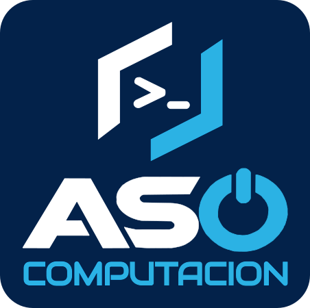
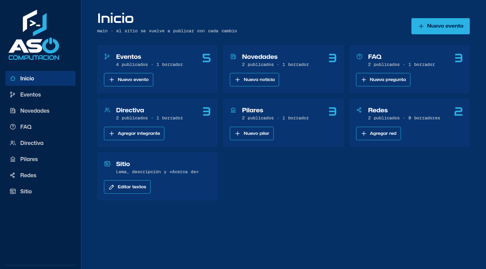
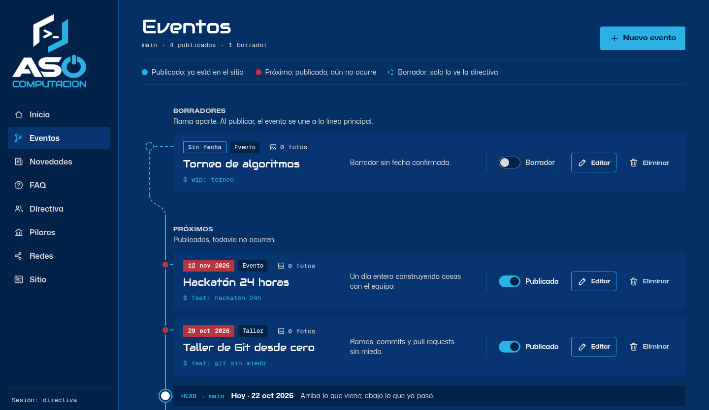
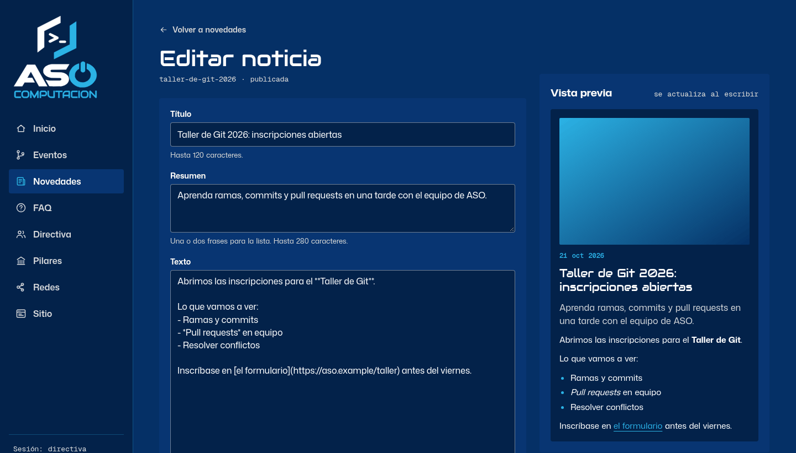
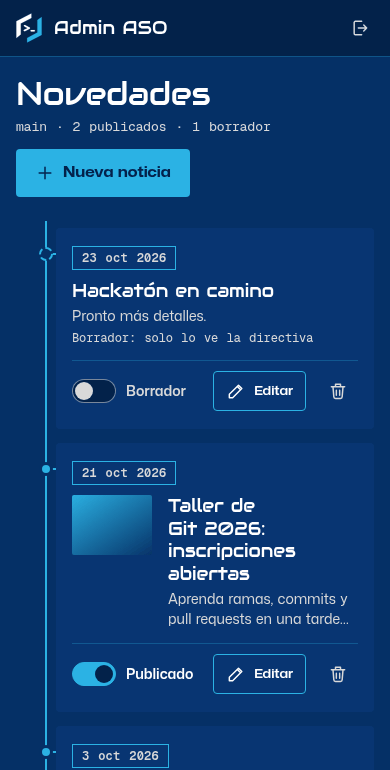

<div align="center">



# Panel de administración · ASO Computación

**La directiva edita el sitio público de la asociación sin escribir una línea de código.**

[](https://github.com/aso-computacion-unl/aso-computacion-admin/actions/workflows/ci.yml)
[](LICENSE)

[Sitio público](https://aso-computacion-landing.pages.dev) ·
[Panel](https://aso-computacion-admin.vercel.app) (acceso solo para la directiva) ·
[Documentación](#documentación)

</div>

## Qué es

Este panel permite que la directiva de ASO Computación mantenga el contenido del [sitio público](https://aso-computacion-landing.pages.dev): eventos con fotos, noticias, preguntas frecuentes, directiva, pilares, redes sociales y textos del sitio. Cada cambio publicado actualiza el sitio en pocos segundos, sin pasar por el código.

<table>
  <tr>
    <td width="50%"><br><sub><b>Inicio:</b> un resumen de cada sección.</sub></td>
    <td width="50%"><br><sub><b>Eventos:</b> borradores, próximos y pasados en una línea de tiempo.</sub></td>
  </tr>
  <tr>
    <td width="50%"><br><sub><b>Noticias:</b> la vista previa se actualiza mientras se escribe.</sub></td>
    <td width="50%" align="center"><br><sub><b>En el teléfono:</b> el panel también se usa desde el celular.</sub></td>
  </tr>
</table>

> Las capturas usan datos de demostración.

## Qué permite

| Sección | Qué se administra |
|---|---|
| **Eventos** | Fechas (o solo el mes), tipo, enlace y galería de fotos; se pueden dejar como borrador |
| **Novedades** | Noticias con portada, fecha de publicación y vista previa en vivo |
| **FAQ** | Preguntas y respuestas, con el orden que se desee |
| **Directiva** | Nombre, cargo y foto de cada integrante (nunca datos de contacto) |
| **Pilares** | Las tarjetas de pilares que presenta el sitio |
| **Redes** | Enlaces a las redes sociales |
| **Sitio** | Lema, descripción y texto «Acerca de» |

Cada elemento se puede publicar u ocultar cuando se desee, y nada llega al sitio hasta que se publica. Las listas (FAQ, directiva, pilares y redes) también se pueden reordenar.

## Tecnologías

| Capa | Herramientas |
|---|---|
| Aplicación | Next.js 15 · React 19 · TypeScript |
| Datos | Prisma · PostgreSQL en Neon |
| Imágenes | Cloudinary |
| Despliegue | Vercel |
| Calidad | Arquitectura hexagonal · Vitest · CI en GitHub Actions |

## Probarlo en local

Se necesita **Node 22** y una base de datos PostgreSQL propia (Docker sirve para levantar una). No debe usarse la de producción.

```sh
cp .env.example .env      # completar los valores __REPLACE_*__
npm ci
npx prisma migrate deploy
npm run dev               # http://localhost:3000
```

Las variables de entorno están explicadas en la [referencia técnica](docs/REFERENCIA.md#environment-variables) y el despliegue paso a paso, en la [guía de despliegue](docs/DEPLOY.md).

## Cómo colaborar

El contenido se edita desde el panel, sin tocar el código. Los cambios de código entran por Pull Request contra `main`, con una aprobación y la CI en verde. Los errores y las ideas se reportan abriendo un issue.

La guía completa está en [CONTRIBUTING.md](CONTRIBUTING.md). Las vulnerabilidades se reportan en privado, como indica [SECURITY.md](SECURITY.md).

## Documentación

| Documento | Para qué sirve |
|---|---|
| [README](README.md) | Presentación del proyecto (este documento) |
| [CONTRIBUTING.md](CONTRIBUTING.md) | Flujo de trabajo, reglas del código y buenas prácticas para la directiva |
| [docs/DEPLOY.md](docs/DEPLOY.md) | Despliegue en Vercel, Neon y Cloudinary, con la lista de verificación |
| [docs/REFERENCIA.md](docs/REFERENCIA.md) | Referencia técnica: reglas, contratos y decisiones (en inglés) |
| [SECURITY.md](SECURITY.md) | Cómo reportar una vulnerabilidad |

## Licencia

Proyecto de ASO Computación bajo licencia [MIT](LICENSE).
