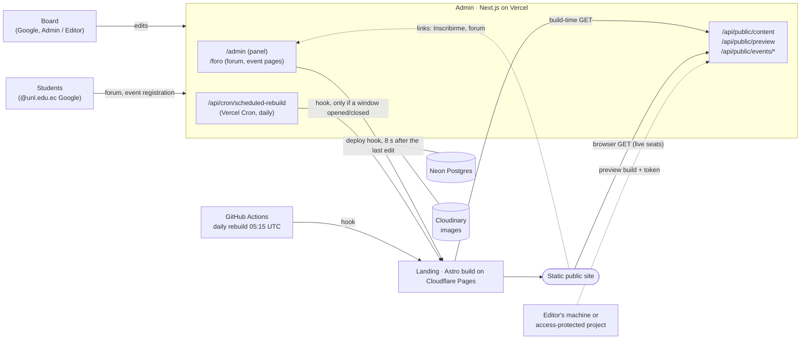

> Arquitectura del sistema completo (panel de administración y sitio público): quién es dueño de qué, cómo fluye el contenido, identidades, entornos y CI. Para el detalle de cada parte, lea la [referencia técnica](REFERENCIA.md) y la [guía de despliegue](DEPLOY.md); para empezar, el [README](../README.md).

# ASO Computación — System architecture

ASO Computación runs as **two repositories and one data flow**. The **admin** (`aso-computacion-admin`, this repository) is a Next.js app with the only database: the board edits content there, and it also hosts the student forum and the event registration pages. The **landing** (`aso-computacion-landing`) is a static Astro site with no server: at build time it reads the admin's public JSON and bakes it into pages. Anything the board publishes reaches the public site through a rebuild, not instantly.

## What each repository owns

| | Admin (`aso-computacion-admin`) | Landing (`aso-computacion-landing`) |
|---|---|---|
| Kind | Next.js 16 App Router, server actions, Prisma 7 | Astro 7, static output, Tailwind, GSAP |
| Hosting | Vercel (Production; previews should get no production variables) | Cloudflare Pages (`dist/`) |
| Data | Postgres on Neon (all content, users, sessions, audit log, forum, registrations) and images on Cloudinary | None. Content comes from the admin at build time; `src/data/fallback.json` is a committed snapshot used when the admin is unavailable |
| Owns | Content model and rules (events, news, FAQ, free terminal commands, board, pillars, socials, sponsors, site texts), publication windows, trash, audit log, forum, event registration, the public JSON contract | Design, fixed copy (Spanish and `/en/`), the build-time validation of the JSON, the production content gate, preview builds, the live-seats widget |
| Runs at request time | Everything (pages, actions, API) | Nothing, except one browser `GET` for seats |
| Package manager | npm (`package-lock.json`) | pnpm only |

The contract between them is **`GET /api/public/content`**: one JSON snapshot of published, non-trashed content (`src/interface/public/public-content.mapper.ts`, documented in [Public read API](REFERENCIA.md#public-read-api)). Fields are only ever added; `schemaVersion` moves on a breaking change. The landing validates the payload on every build and rejects any `version` it does not know (`src/lib/admin-content/validate.ts` in the landing), so a contract change is a coordinated PR in both repositories.

## How content flows

1. **Edit.** A board member changes content in the admin. Each mutation is a server action that checks the session and role first, writes to Postgres, writes an audit entry and calls `requestSiteRebuild()` (`src/infrastructure/deploy/deploy-hook.ts`). Nothing is public until an item is published; events and news may also carry a publish window.
2. **Rebuild request.** The admin POSTs the Cloudflare Pages **deploy hook** 8 s after the last edit of a burst (15 s at most), so several quick edits make one build. Best effort: a failed call never fails the edit. The dashboard shows the last attempt ("Último despliegue"); OK means Cloudflare accepted the request, not that the build finished.
3. **Build.** Cloudflare runs `pnpm build`. The landing fetches `ADMIN_CONTENT_URL` (10 s timeout), validates it and renders static pages. On the production branch a build that would fall back to the committed snapshot **fails** and the previous deployment stays live (the content gate, landing `docs/DEPLOY.md`); other builds fall back with a warning.
4. **Other triggers.** Three safety nets exist, each for a different reason:

   | Trigger | Where | When | Why |
   |---|---|---|---|
   | Admin cron | `vercel.json` → `/api/cron/scheduled-rebuild` | 11:00 UTC daily (06:00 Ecuador), Bearer `CRON_SECRET` | Rebuild only if a published event or news item opened or closed its publish window since the last accepted hook; also runs the registration retention purge |
   | Landing daily rebuild | `.github/workflows/daily-rebuild.yml` in the landing | 05:15 UTC daily | Moves "today" forward (upcoming vs. past is fixed at build time, Ecuador time) and repairs lost hook calls |
   | Manual | Cloudflare "retry deployment", the hook URL, or GitHub "Run workflow" | On demand | Emergencies, after seeding |

5. **Previews.** An Editor or Admin mints a preview code in `/admin/vista-previa` (1 h, 24 h or 7 days). A **preview build** of the landing (`PREVIEW_BUILD=1`) fetches `GET /api/public/preview` with the header `X-Preview-Token` and shows drafts and scheduled items with a banner and `noindex`. It runs locally or in a separate Cloudflare Pages project behind Cloudflare Access, and the build refuses to run on the public project. Tokens are stateless: rotate `PREVIEW_TOKEN_SECRET` to revoke them all.
6. **Live seats.** Registration seats change faster than a build, so the landing's page makes one browser `GET <admin>/api/public/events/seats` (no credentials, 4 s timeout) and shows seats left. If it fails, tickets keep the capacity they were built with and the admin stays the authority.

## Identities

Three unrelated ways in, each with its own cookie, secret and guard. A cookie of one kind never passes the guard of another (both directions are tested in `src/tests/unit/interface/forum/require-forum-member.test.ts`).

| Identity | Who | Sign-in | Cookie and store | Guard |
|---|---|---|---|---|
| **Admin user** | The board, role `ADMIN` or `EDITOR` | Google (authorization code + PKCE), only emails on the Usuarios list, added by single-use invitation link (7 days) or `ADMIN_BOOTSTRAP_EMAILS` for the first admin | `admin_session`, 24 h, signed with `ADMIN_SECRET`; each login is a revocable `Session` row; the role is read from the `User` row on every request | `requireSession()` / `requireRole("ADMIN")` on every action; `requirePageSession()` on pages; the proxy (`proxy.ts`, Node runtime; cookie signature only) on `/` and `/admin/*`; the proxy also answers `400` for any matched path with a malformed percent escape, without touching the session |
| **Break-glass** | Anyone with the shared emergency password | `/login` with `ADMIN_PASSWORD`, available only while Google is not configured or when `BREAK_GLASS_PASSWORD_LOGIN=1`; throttled in Postgres | Same cookie, session `kind` `break_glass`, acts as a synthetic admin, banner on every page, audited | Same guards; switching it off rejects open emergency sessions |
| **Forum member** | Students with an `@unl.edu.ec` Google account (email verified, `hd` matching `FORUM_ALLOWED_EMAIL_DOMAIN`) | Google at `/foro/auth/google/start`; the first valid login creates the member | `forum_session` (path `/foro`, 7 days, signed with `FORUM_SESSION_SECRET`); `ForumMember` / `ForumSession` tables, not `User` | `requireForumMember()` / `requireForumPageMember()` |

Anonymous callers use the public API only: no session, rate limited per client (best effort per instance), CORS allowlist `PUBLIC_CORS_ORIGINS` for the content API (the seats endpoint answers any origin).

## Where the forum and registration live

Both live **in the admin app**, on the admin's origin, not in the landing. The landing only links to them (`<admin>/foro`, `<admin>/foro/eventos/<slug>`) and refuses links to any other origin.

- **Forum** (`app/foro/**`): categories, threads, replies, reactions, best answer, reports. Moderation is in the panel (`/admin/foro/reportes`, Editor level). Forum categories are managed by admins at `/admin/foro/categorias` (Admin only).
- **Event registration**: each event chooses `none`, `unl` (a signed-in forum member, no data taken from the caller) or `open` (a form on the event page with Cloudflare Turnstile that POSTs to `/api/public/events/<slug>/registrations`). Seats and deadline are enforced atomically in the database. Registrations are personal data: Admin-only export and delete, deleted automatically 90 days after the event by the daily cron.

## Environments and deploy

| Environment | Admin | Landing |
|---|---|---|
| Production | Vercel project, Node 22, `npm ci` / `npm run build`, Neon + Cloudinary; migrations applied by hand with `prisma migrate deploy` against the direct connection string, **before** deploying code that needs them | Cloudflare Pages, production branch `main`, `pnpm build`, output `dist`; the admin's deploy hook and the daily workflow trigger builds |
| Preview deployments | Vercel previews should get **no** production variables (a preview sharing the database would let any branch edit live content; [DEPLOY.md](DEPLOY.md#3-vercel) step 5) | Pages preview branches build from the fallback snapshot with a warning; a separate access-protected project serves preview builds |
| Local | `npm run dev` with your own Postgres; Google optional (password login otherwise); `npm run seed:demo` for sample data | `pnpm dev`; without `ADMIN_CONTENT_URL` it uses the fallback snapshot |
| CI | Throwaway Postgres in Docker, test-only credentials, no secrets | Build from the fallback snapshot, no secrets |

Setup steps live in [DEPLOY.md](DEPLOY.md) here and in the landing's `docs/DEPLOY.md`. The landing's guide states that its Cloudflare and GitHub steps had not yet been exercised against the real accounts when it was written; treat the first deploy as the test.

## Environment variables and secrets

Names only. Mark every secret as Sensitive in the hosting dashboard; never commit a `.env` file. Full meaning, formats and failure behavior: [Environment variables](REFERENCIA.md#environment-variables) and the landing's `docs/DEPLOY.md`.

| Owner | Variable | Kind |
|---|---|---|
| Admin (Vercel) | `DATABASE_URL` (pooled, runtime) | secret |
| | `ADMIN_SECRET`, `ADMIN_PASSWORD` | secrets (cookie signing; emergency login) |
| | `GOOGLE_CLIENT_ID`, `GOOGLE_CLIENT_SECRET`, `AUTH_URL`, `ADMIN_BOOTSTRAP_EMAILS`, `ALLOWED_EMAIL_DOMAIN`, `BREAK_GLASS_PASSWORD_LOGIN` | admin Google sign-in (secret: `GOOGLE_CLIENT_SECRET`) |
| | `FORUM_ALLOWED_EMAIL_DOMAIN`, `FORUM_SESSION_SECRET`, `FORUM_GOOGLE_CLIENT_ID`, `FORUM_GOOGLE_CLIENT_SECRET` | forum identity (secrets: the session secret and the client secret) |
| | `CLOUDINARY_CLOUD_NAME`, `CLOUDINARY_API_KEY`, `CLOUDINARY_API_SECRET`, `CLOUDINARY_FOLDER` | images (secret: the API secret) |
| | `CLOUDFLARE_DEPLOY_HOOK_URL` | secret (the token is part of the URL) |
| | `CRON_SECRET`, `PREVIEW_TOKEN_SECRET` | secrets |
| | `TURNSTILE_SECRET_KEY` (secret), `TURNSTILE_SITE_KEY` (public) | open registration form |
| | `PUBLIC_CORS_ORIGINS` | public config |
| | `SENTRY_DSN`, `NEXT_PUBLIC_SENTRY_DSN`, `SENTRY_TRACES_SAMPLE_RATE`, `NEXT_PUBLIC_SENTRY_TRACES_SAMPLE_RATE`, `SENTRY_AUTH_TOKEN`, `SENTRY_ORG`, `SENTRY_PROJECT` | error tracking (secret: the auth token) |
| Admin (local / CI only) | `TEST_DATABASE_URL` | disposable test database, never on Vercel |
| Landing (Cloudflare Pages) | `ADMIN_CONTENT_URL`, `NODE_VERSION` | config |
| | `PRODUCTION_BRANCH`, `ALLOW_CONTENT_FALLBACK` | content gate (emergency flag, leave unset) |
| | `PUBLIC_CF_BEACON_TOKEN` | optional analytics |
| | `PREVIEW_BUILD`, `PREVIEW_TOKEN` (secret), `ADMIN_PREVIEW_URL`, `PUBLIC_PAGES_PROJECT` | preview builds, preview project only |
| Landing (GitHub Actions secret) | `CLOUDFLARE_DEPLOY_HOOK_URL` | secret, used by the daily rebuild workflow |

The landing carries no Turnstile key and no CORS setting. Rotating `ADMIN_PASSWORD` does not close sessions; rotating `ADMIN_SECRET` closes all of them.

## CI and quality gates

Both repositories run GitHub Actions on every pull request and on `main`, with no secrets. In the admin, `main` is protected by a GitHub ruleset (changes enter by pull request with one approval); the landing requires its `checks` job. Those settings live in GitHub, not in the repository, so this document cannot prove them.

| | Admin (`.github/workflows/ci.yml`) | Landing (`.github/workflows/ci.yml`) |
|---|---|---|
| `checks` | `npm audit --omit=dev --audit-level=high`, `npm run lint`, `npm run typecheck`, `npm run test:coverage` (thresholds in `vitest.config.ts`: lines 77, statements 76, branches 74, functions 71), `npm run build` | `pnpm audit --prod --audit-level high`, `pnpm lint`, `pnpm check` (Astro types), `pnpm format:check`, `pnpm test`, `pnpm build` |
| `integration` | Prisma tests against a disposable Postgres (`npm run test:integration`) | — |
| `e2e` | Playwright (Chromium) against `next start` and a disposable Postgres (`npm run e2e`) | Playwright with axe-core and motion checks against `astro preview` of the fallback build (`pnpm test:e2e`) |
| `lighthouse` | — | Lighthouse CI category budgets (performance ≥ 0.9, accessibility, best practices and SEO ≥ 0.95 on the home pages) |
| Other | Dependabot weekly (minor and patch grouped and auto-merged once required checks pass, majors separate and reviewed); SonarCloud analysis (`.sonarcloud.properties`) | Dependabot weekly, same grouping; SonarCloud analysis (`.sonarcloud.properties`) |

Architecture rules that tests enforce in the admin: layer boundaries (`src/tests/unit/architecture-boundaries.test.ts`), every server action has a role row and a no-session test (`action-policy-coverage.test.ts`), every public route is listed (`route-protection.test.ts`), the public JSON keys are pinned (`public-content.mapper.test.ts`), and every stored-image column is a known media owner (`media-owner-coverage`).

## Known limits

- **Vercel Hobby allows one daily cron**, so scheduled content can appear up to about a day late unless an edit or a manual rebuild happens; on Pro the schedule can go back to every 15 minutes.
- **The preview document has no `sponsors` key** (only the normal content route appends it); the landing treats it as empty.
- **Rate limits are per serverless instance** (best effort); the real protection for the content API is the CDN cache (`s-maxage=5`), which must stay below the deploy-hook debounce.
- **The landing validates `version`, not `schemaVersion`**: the admin must keep emitting both.
